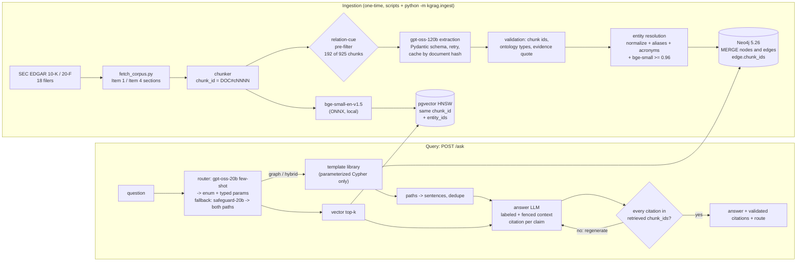
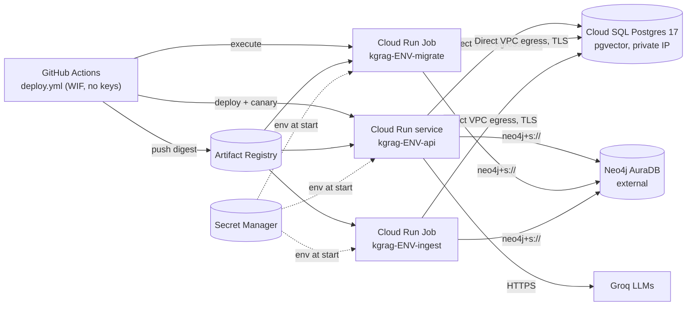

<p align="center">
  <picture>
    <source media="(prefers-color-scheme: dark)" srcset="assets/brand/logo-dark.svg">
    
  </picture>
</p>

<p align="center">
  <b>Multi-hop RAG over SEC filings where the model never writes Cypher and every claim carries a validated citation.</b><br>
  Knowledge graph (Neo4j) + vectors (pgvector), joined on one chunk id. Multi-hop accuracy 38% → 63% against vector-only RAG.
</p>

<p align="center">
  
  <br><sub>A real session against the local stack: live retrieval, llama3.1:8b answers served from the on-disk LLM cache. <a href="assets/demo/README.md">How it was recorded</a>.</sub>
</p>

<p align="center">
  <a href="https://github.com/niravpatidar37/hopcite/actions/workflows/ci.yml"></a>
  <a href="LICENSE"></a>
  
</p>

> **Status: working MVP, local docker compose stack.** The benchmark is small (64 questions, 18
> filings) and was run once; treat the deltas as directional. The cloud deployment is
> deploy-ready but **not applied** (no cloud account connected). Read
> [how to read the numbers](#how-to-read-these-numbers) and [residual risk](#residual-risk) first.

## The problem

- **Vector RAG struggles with multi-hop questions.** Questions that need several pieces of evidence
  joined together ("which foundry used by AMD is also a customer of Lam Research?") are where
  existing RAG systems "perform unsatisfactorily in retrieving and answering"
  ([MultiHop-RAG, Tang & Yang 2024](https://arxiv.org/abs/2401.15391)). Here, vector recall@8 on
  3-hop questions is 0.29 ([`results/recall.json`](results/recall.json)).
- **Citations are often decoration.** An audit of four generative search engines found only 51.5% of
  generated sentences fully supported by their citations, and 74.5% of citations supporting their
  sentence ([Liu et al. 2023](https://arxiv.org/abs/2304.09848)).
- **Text-to-Cypher puts model output into a query language.** Executing model output unchecked is
  OWASP's [LLM05 Improper Output Handling](https://genai.owasp.org/llmrisk/llm052025-improper-output-handling/);
  with a graph database it is Cypher injection.
- Graph RAG helps on corpus-level questions ([GraphRAG, Edge et al. 2024](https://arxiv.org/abs/2404.16130)),
  but most write-ups do not compare against a vector baseline on the *same* index, model and prompt.

## What it does

| | Guarantee (enforced in code, each with a test) |
|---|---|
| **No model-written Cypher** | The router returns a closed enum (route, query type, relation types per hop, direction, target type) plus entity names. Code resolves names to catalog ids and binds them as parameters to one of 10 constant read-only templates, run in a READ session. `tests/test_no_model_cypher.py` throws injection strings and 150 fuzzed router outputs at it. |
| **Validated citations** | Every claim must cite chunk ids the server retrieved for this question. Invalid citations are rejected and regenerated; claims that still fail are dropped, and an answer with none left is a refusal. |
| **One shared key** | `chunk_id` is both the Neo4j `:Chunk` id and the pgvector primary key; every graph edge carries the `chunk_ids` it was extracted from, so a graph fact can always be cited. |
| **Validated extraction** | Triples are checked against a 7-type / 14-relation ontology, and the evidence quote must appear in the cited chunk. |
| **Fair baseline** | `"mode": "vector"` runs the same index, answer model, prompt and passage budget without the graph. |
| **Bounded cost** | A hard spend cap (worst case checked before every paid call), a kill switch, per-key rate limits and a router latency budget with a deterministic fallback. |

Every security control is mutation-tested: 20 of 20 mutants (one per control broken) are killed by the
unit tests ([`results/mutation_check.json`](results/mutation_check.json)).

## Results

64 questions, both systems run on the same set in one interleaved pass
([`results/benchmark_results.jsonl`](results/benchmark_results.jsonl),
[`results/benchmark_summary.json`](results/benchmark_summary.json)). The tables come from
`scripts/make_report.py`, so no number was typed by hand.

| Question type | n | Vector-only RAG | Hybrid graph + vector | Delta |
|---|---:|---:|---:|---:|
| Single-hop | 20 | 65% | 70% | +5 pts |
| 2-hop | 14 | 50% | 71% | +21 pts |
| 3-hop | 10 | 20% | 50% | +30 pts |
| Aggregation | 10 | 50% | 60% | +10 pts |
| Out-of-scope (must refuse) | 10 | 100% | 100% | +0 pts |
| **Multi-hop (2+3 hop)** | 24 | **38%** | **63%** | **+25 pts** |
| **All** | 64 | **58%** | **70%** | **+12 pts** |

| Operational | Vector-only | Hybrid |
|---|---:|---:|
| Mean set-F1 | 0.57 | 0.69 |
| Answers with >=1 validated citation | 100% | 100% |
| p50 latency | 6.9 s | 8.0 s |
| p95 latency | 14.6 s | 15.4 s |
| LLM cost per query (Groq paid rates) | $0.00000 | $0.00008 |
| One-time graph ingestion (extraction, gpt-oss-120b) | - | $0.0802 |

Parity on single hop, then a gap that widens with hop count. The graph costs more to build ($0.08 and
23 minutes of extraction under free-tier rate limits) and adds about 1 s at p50.

### How to read these numbers

- **Small n.** 10 to 20 questions per bucket, so a single question moves a bucket by 5 to 10 points.
  Treat the deltas as directional. No confidence intervals were computed.
- **The router was often unavailable.** The Groq free-tier daily token quota (200K tokens/day per model,
  shared with five other projects) ran out during the run. In 34 of 64 hybrid queries both router
  models were rate-limited, so the pipeline used its designed fallback: deterministic entity linking
  plus both retrieval paths. 28 queries were routed by `gpt-oss-safeguard-20b` (the fallback model) and
  2 by `gpt-oss-20b`. Per-query details are in [`results/routing_log.jsonl`](results/routing_log.jsonl).
- **Answer model.** Both systems answer with local `llama3.1:8b` (Ollama, $0). Latency is that
  model's speed on a 6 GB RTX 3060 laptop GPU, not a property of the retrieval.
- **Scoring is automatic** (set-F1 >= 0.6 with alias matching, exact match for numbers, refusal for
  out-of-scope). In 16 of 128 rows the answer text was used because the model returned no entity
  list (`score.used_text_fallback`). No LLM judge was used here; [kappajudge](https://github.com/niravpatidar37/kappajudge)
  judges these same rows.
- **A validated citation is a retrieved chunk, not a proof.** The check guarantees the cited chunk was
  retrieved for the question; it does not check that the chunk entails the claim. In q041, for
  example, "TSMC is a foundry for Qualcomm" cites a Lam Research chunk.

Other measured artifacts:
- Vector recall on the labeled evidence set ([`results/recall.json`](results/recall.json)): single-hop
  recall@8 = 0.70 (0.80 @10); 3-hop recall@8 = 0.29. HNSW `ef_search=80` gives 1.00 overlap with exact
  search at 2.3 ms (`ef_search=40`: 0.994).
- Entity resolution ([`results/er_tuning.json`](results/er_tuning.json)): on 93 labeled candidate pairs,
  normalization + alias/acronym/generic-suffix rules + bge-small at threshold 0.96 reached
  P = 0.90, R = 0.90, F1 = 0.90. Embedding similarity alone peaked at F1 = 0.37.
- Ingestion is idempotent ([`results/idempotency_check.json`](results/idempotency_check.json)):
  re-running `build` on the built graph gives identical node, edge and row counts and 0 duplicate edges.
- Gold answers are traceable ([`results/gold_verification.json`](results/gold_verification.json)):
  all 113 evidence quotes occur verbatim in the fetched filings.

## Quick start

Requirements: Docker, [uv](https://docs.astral.sh/uv/), Python 3.12 (uv installs it), Ollama with
`llama3.1:8b`. A Groq key (in the env file named by `PORTFOLIO_ENV_FILE`) is optional: without it
the router uses its deterministic fallback.

```bash
uv sync --frozen                       # creates .venv
cp .env.example .env                   # set NEO4J_PASSWORD, POSTGRES_PASSWORD, SEC_USER_AGENT

docker compose -p p1-kgrag up -d neo4j postgres     # neo4j 127.0.0.1:17474/17687, postgres 127.0.0.1:15432
uv run python -m kgrag.migrate up                  # versioned schema migrations (idempotent)
# build the corpus and graph once: see "Rebuild everything from scratch" below

uv run kgrag-api                                   # API on 127.0.0.1:8101 (local Ollama + Groq router)
curl -s http://127.0.0.1:8101/readyz
curl -s -X POST http://127.0.0.1:8101/ask -H 'content-type: application/json' \
  -d '{"question": "Which companies does Supermicro name as competitors?"}'
uv run python assets/demo/ask.py --mode vector "Which companies does Supermicro name as competitors?"

docker compose -p p1-kgrag --profile api up -d --build api   # API in a container (needs KGRAG_API_KEY)
docker compose -p p1-kgrag stop                               # stop (keeps volumes)
```

`POST /ask` takes `{"question": str (3-500 chars), "mode": "hybrid"|"vector"}` (header `X-API-Key`
when `KGRAG_API_KEY` is set) and returns `answer`, `refused`, `route`, `mode`, `citations[]`,
`claims[]`, `answer_entities`, `graph_facts`, `template`, `latency_ms` and `usd`. `GET /healthz` is
liveness, `GET /readyz` checks Neo4j and Postgres (503 when either is down).

<details><summary><b>Rebuild everything from scratch</b> (corpus, graph, benchmark)</summary>

```bash
uv run python scripts/fetch_corpus.py           # EDGAR -> data/raw + data/manifest.json (<= 8 req/s)
uv run python scripts/verify_gold.py            # benchmark quotes must occur verbatim in the filings
uv run python -m kgrag.ingest estimate --pilot 2  # cost estimate + 2-batch pilot
uv run python -m kgrag.ingest extract           # gpt-oss-120b; cached in data/extracted (committed)
uv run python -m kgrag.ingest build             # entity resolution + MERGE into Neo4j + pgvector
uv run python scripts/tune_er.py evaluate       # ER threshold sweep -> results/er_tuning.json
uv run python scripts/eval_recall.py            # recall@k + ef_search sweep -> results/recall.json
uv run python scripts/run_benchmark.py          # both systems, no LLM cache -> results/benchmark_*
uv run python scripts/make_report.py            # README tables
```
</details>

<details><summary><b>Configuration</b> (environment variables)</summary>

| Variable | Default | Meaning |
|---|---|---|
| `NEO4J_URI`, `NEO4J_USER`, `NEO4J_PASSWORD`, `NEO4J_DATABASE` | `bolt://127.0.0.1:17687`, `neo4j`, -, `neo4j` | Graph store |
| `PG_HOST`, `PG_PORT`, `PG_USER`, `PG_DB`, `POSTGRES_PASSWORD`, `PG_SSLMODE`, `PG_POOL_MAX` | `127.0.0.1`, `15432`, `kgrag`, `kgrag`, -, `prefer`, `4` | pgvector store |
| `KGRAG_HOST`, `KGRAG_PORT` (or `PORT`) | `127.0.0.1`, `8101` | API bind; a non-loopback host needs `KGRAG_API_KEY` |
| `KGRAG_API_KEY` | empty | Comma-separated keys (>= 16 chars off loopback) for rotation |
| `KGRAG_ANSWER_PROVIDER`, `KGRAG_ANSWER_MODEL` | `ollama`, `llama3.1:8b` | Answer model (`groq` on Cloud Run) |
| `GROQ_API_KEY` | from `PORTFOLIO_ENV_FILE` | Router LLM; empty = deterministic router fallback |
| `KGRAG_KILL_SWITCH` | `0` | `1` answers 503 and blocks every LLM call |
| `KGRAG_RATE_LIMIT_PER_MIN`, `KGRAG_RATE_LIMIT_BURST` | `30`, `10` | Token bucket per key or client; `0` disables |
| `KGRAG_LLM_CACHE` | `1` | Disk cache of LLM responses by content hash |
| `KGRAG_ROUTING_LOG` | `file` | `file`, `postgres`, `stdout` or `off` |
| `KGRAG_EF_SEARCH`, `KGRAG_ER_THRESHOLD` | `80`, `0.96` | HNSW search width; entity-resolution threshold |
| `KGRAG_LOG_FORMAT`, `KGRAG_READINESS_TIMEOUT_S`, `KGRAG_SHUTDOWN_GRACE_S` | `json`, `3`, `8` | Ops |
| `PORTFOLIO_ENV_FILE`, `KGRAG_LOAD_DOTENV` | `F:/.secrets/portfolio.env`, `1` | Local secrets file; `0` in containers |
| `LLM_SPEND_CAP_USD`, `LLM_SPEND_LEDGER` | `25`, `F:/.llm-spend/ledger.jsonl` | Shared hard spend cap and its ledger |
| `SEC_USER_AGENT` | - | EDGAR User-Agent with a real contact email (corpus fetch only) |
</details>

Tests: `uv run pytest` (no services or secrets needed; 130 pass, 7 integration tests skip).
`KGRAG_INTEGRATION=1 uv run pytest tests/test_integration.py tests/test_migrations_integration.py`
runs the MERGE-idempotency, read-only-session, migration, drift and grant tests against the stack (CI
runs them against service containers). `uv run python scripts/mutation_check.py` runs the
security mutation check.

## Architecture



- **Corpus**: the latest annual report of NVIDIA, AMD, Intel, Micron, Qualcomm, Broadcom, TI, Applied
  Materials, Lam Research, KLA, Marvell, Analog Devices, Supermicro, Synopsys, Cadence, onsemi and
  Microchip (10-K Item 1), plus TSMC (20-F Item 4). Source URLs and SHA-256 hashes are in
  [`data/manifest.json`](data/manifest.json). The raw filings are not committed; `scripts/fetch_corpus.py`
  re-creates them.
- **Ontology** ([`src/kgrag/ontology.py`](src/kgrag/ontology.py)): 7 entity types (Company, Product,
  Technology, Segment, Market, Location, Person) and 14 relation types (COMPETES_WITH, SUPPLIES_TO,
  MANUFACTURES_FOR, CUSTOMER_OF (normalized to SUPPLIES_TO), PARTNERS_WITH, ACQUIRED, SUBSIDIARY_OF,
  OFFERS, HAS_SEGMENT, USES_TECHNOLOGY, SERVES_MARKET, HEADQUARTERED_IN, HAS_FACILITY_IN, EXECUTIVE_OF).
  Allowed subject and object types are enforced per relation.
- **Graph** ([`results/ingest_summary.json`](results/ingest_summary.json)): 494 resolved entities and 501
  typed relations from 522 validated triples (531 extracted; 6 dropped for type violations, 3 for
  evidence not found in the cited chunk). Every edge carries `chunk_ids`.
- **Shared key**: graph facts cite chunk ids, and passages carry the entity ids they mention
  (`entity_ids`), so retrieval can move from graph to text and back.

### Design decisions (trade-offs)

1. **Pay for extraction only on relation-bearing chunks.** A regex pre-filter (relation cue words ×
   organization mentions, plus each document's first two chunks) sends 192 of 925 chunks to
   gpt-oss-120b. A cost estimate and a 2-batch pilot ran first
   ([`results/cost_estimate.json`](results/cost_estimate.json)): $0.085 projected, $0.076 actual for the
   main pass. All 925 chunks are still in the vector index. The cost is recall at extraction time: a
   fact the model skips never reaches the graph. KLA's ">10% of revenue: TSMC" customer table was
   selected but produced no relation, so the KLA -> TSMC edge is missing. All three questions that need
   it (q030, q038, q053) are wrong in both systems.
2. **Template-only Cypher.** Reproducible and closes Cypher injection. The cost is flexibility:
   question shapes outside the library fall back to a one-hop neighborhood (`neighbors_any(fallback)`,
   used in most hybrid rows).
3. **Same answer model, prompt and passage budget for both systems.** Both get 8 passages. The hybrid
   puts up to 4 graph-linked passages first and also gets graph facts as sentences. A local 8B answer
   model keeps per-query cost at $0 and makes the comparison fair. It also caps absolute accuracy:
   wrong refusals and non-answers account for several misses in both columns.
4. **Router with a latency budget and a model fallback chain.** On rate limits the router fails fast
   (no retry-after longer than 8 s), tries `gpt-oss-safeguard-20b` (same size and price), then runs both
   retrieval paths. Low confidence (< 0.6) also runs both paths. Every decision and outcome is logged
   with the question PII-redacted.

## Security model

Threat model: questions come from untrusted users. Filings, and anything later ingested, are untrusted
text that can carry prompt injection or poisoned facts. Model outputs (extraction, routing, answers)
are untrusted.

Controls in code, each with a test that fails when the control is removed (20/20 mutants killed,
`scripts/mutation_check.py`):

| Control | Where | Test |
|---|---|---|
| Model never writes Cypher: closed-enum router schema (`extra="forbid"`), entity names resolved to catalog ids, constant read-only templates, READ session | `router.py`, `graph_store.py` | `tests/test_no_model_cypher.py` (injection strings, 150 fuzzed router outputs, unknown keys) |
| Write-path relation types come only from the `RelationType` enum | `graph_store.merge_relation_cypher` | `test_write_relation_type_comes_from_enum_only` |
| Every citation must be a retrieved chunk id; reject, regenerate, then drop or refuse | `answer.py` | `test_invented_citation_rejected_then_regenerated`, `test_persistent_bad_citations_end_in_refusal` |
| Retrieved text fenced and tag-neutralized; model told to ignore instructions in passages; links and images stripped from answers | `answer.py` | `test_context_is_labeled_and_fenced`, `test_strip_links_removes_exfil_vectors` |
| Extraction evidence must appear in the cited chunk; types checked against the ontology | `extract.py` | `tests/test_extract.py` |
| API key (constant-time compare) when `KGRAG_API_KEY` is set; otherwise loopback clients only | `api.py` | `tests/test_api.py` |
| Input limits: 3-500 chars, control characters stripped, unknown fields rejected | `api.py` | `test_input_validation` |
| Fail-closed startup: a non-loopback `KGRAG_HOST` without an API key of >= 16 chars refuses to start; comma-separated keys allow zero-downtime rotation | `api.assert_safe_binding` | `test_non_loopback_bind_without_key_refused`, `test_main_refuses_before_binding`, `test_multiple_api_keys_for_rotation` |
| Rate limit: token bucket per API key (or client), 429 + `Retry-After` | `ratelimit.py`, `api.py` | `test_rate_limit_returns_429_with_retry_after`, `test_rate_limit_buckets_are_per_api_key` |
| Kill switch: `KGRAG_KILL_SWITCH=1` answers 503 before retrieval and blocks every LLM call (API, router, jobs) | `api.py`, `llm.py` | `test_kill_switch_blocks_ask_before_the_pipeline`, `test_kill_switch_blocks_llm_client_before_any_http` |
| Readiness checks both stores with a timeout; liveness never touches dependencies | `api.py` | `test_readyz_503_when_neo4j_down`, `test_readyz_times_out_on_a_hanging_dependency` |
| Structured JSON logs: PII redacted in messages and fields; exception text never logged | `logs.py` | `test_json_logs_redact_pii_in_message_and_fields`, `test_json_logs_omit_exception_text` |
| Versioned migrations: an edited, already-applied migration stops the run; the runtime DB role gets SELECT on chunks and INSERT on routing_log only | `migrate.py`, `migrations/` | `test_edited_migration_is_drift`, `test_runtime_role_gets_only_its_grants` (integration) |
| Hard spend cap: worst-case estimate checked before every paid call, global $25 and project $5; a corrupt ledger fails closed | `spend.py`, `llm.py` | `tests/test_spend_and_llm.py` |
| SSRF guard: only `https://www.sec.gov` and `https://data.sec.gov` | `corpus.py` | `test_ssrf_guard` |
| PII (emails, phone numbers, SSNs) redacted from routing logs | `router.redact_pii` | `test_routing_log_redacts_pii` |

Also: no secrets in the repo (`.env.example` lists names only, and gitleaks scans the full history in
CI). The container runs non-root from a pinned base digest with a healthcheck. Ports bind to
127.0.0.1. CI uses `permissions: contents: read`, actions pinned by SHA, and no `pull_request_target`.

### Residual risk

- Prompt injection inside a passage can still steer the answer wording. Fencing and instructions are
  defence in depth, not a security boundary. Citation validation stops invented sources but not a
  misleading claim that cites a real (poisoned or unrelated) chunk.
- Data poisoning: a planted document is extracted into the graph like any other. There is no source
  allowlist or provenance trust score.
- The spend check and the ledger write are not one transaction. Two processes can both pass the check
  before either records, so the cap can be overshot by at most one in-flight call per process.
- On Cloud Run, the rate limiter and the LLM spend ledger are per instance (in memory and `/tmp`).
  The effective limits are `limit x max_instances`, and the dollar cap resets when an instance is
  replaced. Groq's own spend limit and the kill switch are the real backstops there; a shared
  Postgres-backed ledger is the fix (not built).
- Without `KGRAG_API_KEY` the API trusts loopback, so anything on the host can call it. Ollama on
  :11434 is unauthenticated, as installed.

<details><summary><b>OWASP Top 10 for LLM Applications (2025) mapping</b></summary>

| Risk | Status here |
|---|---|
| LLM01 Prompt injection | Mitigated in part: fenced, untrusted-labeled context; enum-only router; template-only Cypher. Residual risk above. |
| LLM02 Sensitive information disclosure | Public filings only; PII redacted from logs; secrets kept out of the repo, images and CI. |
| LLM03 Supply chain | `uv.lock`, pip-audit, Trivy image scan, digest-pinned images, SHA-pinned actions. |
| LLM04 Data and model poisoning | Evidence-in-chunk check at extraction. No defence against a fluent planted document. |
| LLM05 Improper output handling | Model output validated by Pydantic; never executed as code, SQL or Cypher; links stripped. |
| LLM06 Excessive agency | No tools, no writes at query time (READ session). |
| LLM07 System prompt leakage | Prompts hold no secrets; the leakage probe is an out-of-scope benchmark item (refused). |
| LLM08 Vector and embedding weaknesses | Single-tenant index. Retrieved chunks are treated as untrusted. |
| LLM09 Misinformation | Citation per claim, validated against retrieved ids; refusal on empty context. |
| LLM10 Unbounded consumption | Input length limit, per-key rate limit, router latency budget, hard dollar cap, kill switch, bounded retries and timeouts, Cloud Run max instances. |
</details>

## What did not work

- **Embedding similarity is a weak signal for company-name resolution.** bge-small scores "AMD" vs
  "Intel" at 0.77 and "Qualcomm Incorporated" vs its subsidiary "Qualcomm Technologies" at 0.96. Alone
  it peaked at F1 = 0.37. The deterministic rules do the work: aliases the text defines
  (`"Advanced Micro Devices, Inc. ("AMD")"`), acronyms, and stripping generic trailers ("Cisco Systems,
  Inc." = "Cisco"). The tuned threshold (0.96) adds no correct merges on the labeled pairs. The labels
  were made by the build agent, and the threshold was tuned on the same pairs it is scored on, with no
  held-out split.
- **Free-tier quotas shaped the system.** Groq allows 8K tokens/minute and 200K tokens/day per model,
  shared across six projects. Extraction took 23 minutes. Answering 128 benchmark queries on
  gpt-oss-120b would not fit the daily quota, so answers run on local llama3.1:8b (a deviation from
  answering with the extraction model). The router's daily quota ran out mid-benchmark (see Results).
- **Three benchmark runs were aborted before the reported one**, each for a design change:
  (1) after 8 questions it was clear that graph-routed queries dropped the vector passages, so the
  hybrid now always merges vector passages; (2) a rate-limited router call took 207 s, which led to the
  router latency budget; (3) the gpt-oss-20b daily quota ran out, which led to the fallback chain. A
  router few-shot example that overlapped a benchmark question was also replaced, and a test now guards
  against overlap. The reported numbers come from a single clean run after these changes. Earlier
  partial runs are not reported. Seeing the first few questions influenced change (1).
- **The 8B answer model** sometimes answers "the filings do not mention X" next to a passage that states
  X, lists entities when asked "how many" (both systems miss q043 and q045), or mis-routes an
  answerable question as out of scope (q019, q051 in the hybrid). It needed 7 citation regenerations
  across 128 answers.
- **Parsing gaps**: ASML's 20-F (an integrated annual report with no parseable Item 4) and Arm's 20-F
  were dropped. Intel's 10-K needed a custom section override. SEC EDGAR rejects
  `users.noreply.github.com` contact emails with HTTP 403, so `SEC_USER_AGENT` must carry a real address.

## Cost

Actual spend, read from the shared ledger (project `p1-kgrag`): **$0.0890 total**. That is $0.0802 on
gpt-oss-120b (45 calls: the extraction pass, its 2-batch pilot and three short probes), $0.0035 on
gpt-oss-20b (27 calls: router, probes, dev checks) and $0.0053 on gpt-oss-safeguard-20b (30 calls,
mostly the router fallback). Groq calls are priced at Groq's published paid rates
(`src/kgrag/pricing.json`, an estimate to verify against the pricing page), even though the key is free
tier. Local Ollama and embeddings cost $0. The Claude adapter is present but off: it needs
`ANTHROPIC_API_KEY`, and its model id is a placeholder to verify with `GET /v1/models`.

Resume line: *Built a hybrid knowledge-graph and vector RAG system over 18 SEC filings (925 chunks, 494
resolved entities); raised multi-hop question accuracy from 38% to 63% against a vector baseline at
15.4 s p95 (local 8B answer model), for $0.09 of total LLM spend.*

## Deployment

**Status: deploy-ready; not applied (no cloud account connected).** Terraform validates, lints and
scans clean in CI, and the deploy workflow is wired end to end, but nothing has been provisioned or
deployed. Target: Google Cloud Run, provisioned by Terraform. The deploy workflow is skipped until the
repository variable `GCP_PROJECT_ID` is set.

- [docs/RUNBOOK.md](docs/RUNBOOK.md): bootstrap, first deploy, verify, rollback, secret rotation,
  kill switch, common incidents (exact `gcloud` / `terraform` commands).
- [docs/SLO.md](docs/SLO.md): SLIs/SLOs (availability, latency, quality) and a monthly cost estimate
  (~$325 prod / ~$118 staging at 100k queries/month; an estimate from cited list prices).



| Piece | Deploy-ready (in this repo, checked in CI or locally) | Assumed / not verified |
|---|---|---|
| Terraform ([`infra/terraform`](infra/terraform)) | Module + `envs/staging` and `envs/prod` (tfvars), google provider 8.7.0 pinned in committed `.terraform.lock.hcl`, GCS backend via `-backend-config`. Cloud Run v2 service (min/max instances, CPU/memory, concurrency, startup probe on `/readyz`, liveness on `/healthz`, ingress), migrate + ingest jobs, one service account per workload with per-secret access, Secret Manager containers (no values), Artifact Registry (immutable tags), VPC + Direct VPC egress, Private Service Access, Cloud SQL PG17 (private IP, TLS only, PITR). DB passwords are generated as ephemeral values through write-only arguments, so they never enter state. `fmt`, `validate`, `tflint` (google ruleset) and Checkov pass. | Never planned against a real project (`validate` checks schema, not API-side rules such as tier/edition combinations, quotas or org policies). |
| Neo4j | AuraDB as an external dependency; URI/user/password in Secret Manager; driver liveness checks for idle connections; constraints applied by an idempotent migration. | AuraDB instance created by hand; no private networking to Aura (TLS over the internet). |
| Embedding model | Baked into the image at build time from a pinned Hugging Face revision with a sha256 check; the build proves it loads offline; runtime sets `HF_HUB_OFFLINE=1`. Verified locally with `docker run --network none`. | - |
| Migrations | `python -m kgrag.migrate up` (numbered SQL + `schema_migrations`, advisory lock, checksum drift detection; Neo4j constraints recorded on `:SchemaMigration`), run by CD as a Cloud Run Job before each deploy. CI applies them twice to real Postgres + Neo4j containers. | Expand-only discipline is a convention, not enforced. |
| App controls | `/healthz` vs `/readyz`, fail-closed API-key requirement off loopback, key rotation, per-key rate limit, kill switch, JSON logs with PII redaction, graceful shutdown, env-only config in containers, routing log to Postgres. | Cloud Run behaviour (probes, SIGTERM timing) only exercised locally in Docker. |
| CD ([`.github/workflows/deploy.yml`](.github/workflows/deploy.yml)) | Build once, push, deploy by digest; staging migrate + deploy + smoke; prod behind the `production` environment; 0%-traffic candidate, smoke, canary %, soak, promote; automatic rollback to the previous revision. | Never executed against GCP. |
| Answer model | Cloud uses Groq `gpt-oss-20b` (Cloud Run has no Ollama). | **The published accuracy and latency numbers came from local `llama3.1:8b` and do not transfer**; re-run the benchmark with the cloud model before quoting cloud numbers. |

One-time bootstrap (full commands in the runbook, section 1): create a GCS state bucket, a Workload
Identity pool + OIDC provider restricted to `niravpatidar37/hopcite` on `main`, and a `kgrag-deployer`
service account; set repository variables `GCP_PROJECT_ID`, `GCP_REGION`, `GCP_WIF_PROVIDER`,
`GCP_DEPLOY_SA` (variables, not secrets) and a `production` environment with a required reviewer; then
`terraform apply` staging and prod.

## Project layout

```text
src/kgrag/          Python package (named kgrag; the distribution is still kg-rag-enterprise)
  api.py            FastAPI app: /ask, /healthz, /readyz, /health; auth, limits, kill switch
  router.py         closed-enum router schema, entity catalog, model fallback chain
  graph_store.py    the 10 constant Cypher templates, READ sessions, MERGE ingestion
  vector_store.py   pgvector HNSW search keyed by chunk_id
  answer.py         fenced context, claim/citation validation, regenerate or refuse
  extract.py        validated triple extraction; resolve.py: entity resolution
  llm.py, spend.py  provider-agnostic client, disk cache, hard spend cap
  migrations/       numbered SQL + Neo4j constraints (python -m kgrag.migrate)
bench/              64 questions with traceable gold evidence
data/               manifest (hashes), committed extraction cache, entity catalog
results/            every number in this README
scripts/            corpus fetch, benchmark, recall, ER tuning, mutation check, report
infra/terraform/    Cloud Run module + staging/prod envs (deploy-ready, not applied)
assets/brand/       logo, icons, social preview (generated by tools/build_brand.py)
assets/demo/        demo.gif, recorder and the scripts it runs
```

## Contributing and security

Found a way to get model output into Cypher, or a citation that was never retrieved? Please report it
privately: see [SECURITY.md](SECURITY.md). For everything else, see [CONTRIBUTING.md](CONTRIBUTING.md).

## License

MIT. See [LICENSE](LICENSE). Brand assets and usage: [assets/brand](assets/brand/README.md).
